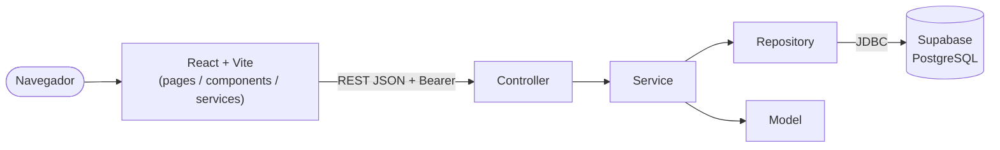

# 🚗 DriveNow – Sistema de Aluguel de Carros

> [!NOTE]
> Sistema web para **gestão de aluguéis de automóveis**: clientes criam, modificam, consultam e cancelam pedidos pela Internet; agentes (empresas e bancos) avaliam financeiramente os pedidos e executam os contratos. Projeto do **Laboratório 02 – DIAW** (Engenharia de Software – PUC Minas).

---

## 🚧 Status do Projeto


---

## 📚 Índice

- [Links Úteis](#-links-úteis)
- [Sobre o Projeto](#-sobre-o-projeto)
- [Funcionalidades Principais](#-funcionalidades-principais)
- [Tecnologias Utilizadas](#-tecnologias-utilizadas)
- [Arquitetura](#-arquitetura)
- [Instalação e Execução](#-instalação-e-execução)
- [Deploy no Render](#-deploy-no-render)
- [Estrutura de Pastas](#-estrutura-de-pastas)
- [Demonstração](#-demonstração)
- [Testes](#-testes)
- [Documentações utilizadas](#-documentações-utilizadas)
- [Autores](#-autores)
- [Contribuição](#-contribuição)
- [Agradecimentos](#-agradecimentos)
- [Licença](#-licença)

---

## 🔗 Links Úteis

* 🌐 **Demo Online:** [Abrir DriveNow no menu](https://diaw-completo.onrender.com/#lab2). No menu, clique em **Iniciar e abrir** para iniciar a aplicação.
- 📖 **Modelagem UML:** [Casos de Uso](docs/casos-de-uso.md) · [Histórias de Usuário](docs/historias-de-usuario.md) · [Diagrama de Classes](docs/diagrama-de-classes.md) · [Diagrama de Pacotes](docs/diagrama-de-pacotes.md)
- 🗄️ **Banco de dados:** [Supabase](https://supabase.com/docs)

---

## 📝 Sobre o Projeto

Locadoras, empresas e bancos precisam de um canal único para receber, analisar e formalizar pedidos de aluguel de veículos. O **DriveNow** resolve isso com um sistema web em que:

- o **cliente** (usuário individual) se cadastra, informa seus dados (RG, CPF, nome, endereço, profissão e até 3 rendimentos com entidade empregadora) e **cria, modifica, consulta e cancela** pedidos de aluguel;
- os **agentes** (empresas e bancos) **modificam e avaliam** os pedidos do ponto de vista financeiro; com parecer positivo o pedido fica apto à **execução do contrato**;
- o aluguel pode estar associado a um **contrato de crédito** concedido por um banco agente;
- o automóvel (matrícula, ano, marca, modelo, placa) pode ser propriedade do **cliente, empresa ou banco**, conforme o tipo de contrato.

Contexto: trabalho acadêmico (Laboratório 02 – DIAW). O sistema só pode ser usado após **cadastro e login**.

---

## ✨ Funcionalidades Principais

- 🔐 **Autenticação:** cadastro e login (usuário e senha com BCrypt, token JWT HS256); rotas protegidas.
- 👤 **CRUD de Cliente:** criar, consultar, alterar e excluir o próprio cadastro (CPF único, máx. 3 rendimentos).
- 📝 **Pedidos de aluguel:** criar, modificar, consultar e cancelar; acompanhamento do **status** do pedido.
- 🏦 **Avaliação por agentes:** parecer financeiro (aprovar/rejeitar), execução do contrato e concessão de crédito (bancos).
- 🛡️ **Perfis de acesso:** CLIENTE, EMPRESA e BANCO com regras distintas.
- ✅ **Validações** no back-end (Bean Validation) e tratamento global de erros.

### Fluxo de status do pedido

`EM_ANALISE → APROVADO → CONTRATADO`, com saídas `REJEITADO` (agente) e `CANCELADO` (cliente). Veja o [diagrama de estados](docs/diagrama-de-classes.md).

---

## 🛠 Tecnologias Utilizadas

### 💻 Front-end

* **Biblioteca:** React 19 + React Router 7
- **Linguagem:** JavaScript (ES6+)
- **Estilização:** CSS puro
- **Estado:** Context API (`AuthContext`)
- **Build Tool:** Vite 7

### 🖥️ Back-end

* **Linguagem:** Java – JDK 25
- **Framework:** Spring Boot 4.0.x (Spring MVC)
- **Build/dependências:** Apache Maven
- **Banco de dados:** Supabase (PostgreSQL)
- **ORM:** Spring Data JPA / Hibernate
- **Autenticação:** login obrigatório; senha com BCrypt (`spring-security-crypto`); token JWT HS256

---

## 🏗 Arquitetura

O back-end segue a arquitetura **MVC em camadas**:

- **Model** (`model`): entidades JPA – `Usuario`, `Cliente`, `Rendimento`, `Automovel`, `PedidoAluguel`, `ContratoCredito`.
- **Controller** (`controller`): endpoints REST (`/api/auth`, `/api/clientes`, `/api/pedidos`).
- **View**: o front-end React consome o JSON (DTOs em `dto`) e constrói as páginas dinamicamente.
- **Service** (`service`): regras de negócio e de autorização por perfil.
- **Repository** (`repository`): acesso a dados (Spring Data JPA) ao Supabase.
- **Security/Config/Exception**: interceptor de login (Bearer token), CORS e tratamento global de erros.

O sistema divide-se nos dois subsistemas do enunciado: **gestão de pedidos e contratos** (back-end) e **construção dinâmica das páginas web** (front-end).



### Diagramas

| Diagrama | Arquivo |
| :--- | :--- |
| Casos de Uso | [docs/casos-de-uso.md](docs/casos-de-uso.md) |
| Histórias do Usuário | [docs/historias-de-usuario.md](docs/historias-de-usuario.md) |
| Classes (+ estados do pedido) | [docs/diagrama-de-classes.md](docs/diagrama-de-classes.md) |
| Pacotes (Visão Lógica) | [docs/diagrama-de-pacotes.md](docs/diagrama-de-pacotes.md) |

### API REST

| Método | Rota | Perfil | Descrição |
| :--- | :--- | :--- | :--- |
| POST | `/api/auth/register` | público | Cadastro de usuário |
| POST | `/api/auth/login` | público | Login (retorna token) |
| GET | `/api/auth/me` | autenticado | Usuário logado |
| GET/POST | `/api/clientes` | autenticado | Listar / criar cadastro de cliente |
| GET/PUT/DELETE | `/api/clientes/{id}` | dono (GET: agentes) | Consultar / alterar / excluir |
| GET/POST | `/api/pedidos` | autenticado / cliente | Listar / criar pedido |
| GET/PUT | `/api/pedidos/{id}` | dono ou agente | Consultar / modificar |
| POST | `/api/pedidos/{id}/cancelar` | cliente | Cancelar |
| POST | `/api/pedidos/{id}/avaliacao` | agente | Aprovar/rejeitar com parecer |
| POST | `/api/pedidos/{id}/contrato` | agente | Executar contrato |
| PUT | `/api/pedidos/{id}/credito` | banco | Conceder contrato de crédito |

---

## 🔧 Instalação e Execução

### Pré-requisitos

* **Java JDK 25**
- **Apache Maven 3.9+**
- **Node.js 20.19+** (ou 22+) e **pnpm**
- Projeto no **Supabase** (já criado)

### 🔑 Variáveis de Ambiente

#### Back-end (`backend/.env`)

Copie `backend/.env.example` para `backend/.env` (o Spring lê esse arquivo automaticamente).

| Variável | Descrição | Exemplo |
| :--- | :--- | :--- |
| `SPRING_DATASOURCE_URL` | URL JDBC do Supabase | `jdbc:postgresql://db.<ref>.supabase.co:5432/postgres` |
| `SPRING_DATASOURCE_USERNAME` | Usuário | `postgres` |
| `SPRING_DATASOURCE_PASSWORD` | **Senha do banco** (definida no Supabase) | `********` |
| `JWT_SECRET` | Chave do token (≥ 32 caracteres) | `uma-chave-longa-e-aleatoria...` |
| `SERVER_PORT` | Porta da API | `8080` |

> [!IMPORTANT]
> No Supabase: **Connect → Connection string → JDBC**. A conexão direta (`db.<ref>.supabase.co`) usa IPv6; se a sua rede for apenas IPv4, use o **Session pooler** (usuário `postgres.<ref>`, host `aws-0-<região>.pooler.supabase.com`, porta `5432`). Nunca versione o `.env`.

#### Front-end (`frontend/.env`)

| Variável | Descrição | Exemplo |
| :--- | :--- | :--- |
| `VITE_API_URL` | URL base da API | `http://localhost:8080/api` |

### 💾 Banco de Dados (Supabase)

As tabelas (`usuario`, `cliente`, `cliente_rendimento`, `automovel`, `pedido_aluguel`, `contrato_credito`) são **criadas automaticamente** pelo Hibernate na primeira execução (`ddl-auto: update`). Em seguida, rode [`docs/supabase-rls.sql`](docs/supabase-rls.sql) no SQL Editor do Supabase para bloquear o acesso direto pela API pública (o acesso é feito apenas via Spring Boot).

### ⚡ Como Executar

Na raiz da pasta `LAB2`, instale as dependências do workspace:

```bash
pnpm install
```

Depois, inicie o back-end e o front-end juntos no mesmo terminal:

```bash
pnpm dev
```

O comando `pnpm start` também inicia os dois serviços. O terminal exibe os logs de cada um; use `Ctrl+C` para encerrar ambos.

- 🚀 API: **<http://localhost:8080>**
- 🎨 Aplicação: **<http://localhost:5173>**

### 🧭 Roteiro de uso (teste rápido)

1. Cadastre uma conta **Cliente** → complete o cadastro (CPF, RG, endereço, profissão, rendimentos).
2. Crie um **pedido de aluguel** → status _Em análise_.
3. Saia e cadastre uma conta **Banco** (ou **Empresa**) → abra o pedido → registre o **parecer** (aprovar) → **Executar contrato** / conceder **crédito**.
4. Volte como cliente e veja o status atualizado.

---


> [!NOTE]
> Instâncias gratuitas podem suspender após inatividade; a primeira requisição depois da suspensão pode demorar enquanto o serviço reinicia. O banco Supabase continua sendo externo ao Render.

### Build local para produção

```bash
pnpm --dir frontend build
mvn -f backend/pom.xml clean package
```

---

## 📂 Estrutura de Pastas

```
.
├── README.md
├── LICENSE
├── .gitignore
├── Dockerfile                      # Docker multi-stage para Render
├── .dockerignore
├── commits                         # Ordem sugerida de 15 commits
├── pnpm-workspace.yaml
├── package.json
├── pnpm-lock.yaml
├── docs/                          # UML (Mermaid), logo e SQL de RLS
│   ├── casos-de-uso.md
│   ├── historias-de-usuario.md
│   ├── diagrama-de-classes.md
│   ├── diagrama-de-pacotes.md
│   └── supabase-rls.sql
├── frontend/                      # React + Vite
│   ├── .env.example
│   ├── index.html · vite.config.js · package.json
│   └── src/
│       ├── components/            # Navbar, PrivateRoute, StatusBadge
│       ├── context/               # AuthContext (sessão)
│       ├── pages/                 # Login, Register, Clientes, Pedidos, PedidoForm, PedidoDetalhe
│       ├── services/              # api.js (chamadas HTTP)
│       ├── styles/ · utils/
└── backend/                       # Spring Boot (MVC)
    ├── .env.example · pom.xml
    └── src/
        ├── main/java/br/pucminas/diaw/aluguel/
        │   ├── controller/        # AuthController, ClienteController, PedidoController
        │   ├── service/           # AuthService, ClienteService, PedidoService
        │   ├── repository/        # Spring Data JPA
        │   ├── model/             # Entidades e enums
        │   ├── dto/               # Requests/Responses
        │   ├── security/          # TokenService (JWT), AuthInterceptor
        │   ├── config/            # CORS, interceptor, BCrypt
        │   └── exception/         # ApiException + handler global
        ├── main/resources/application.yml
        └── test/java/...          # TokenServiceTest
---

## 🧪 Testes

```bash
cd backend
mvn test
```

*Ferramenta: JUnit 5 (`TokenServiceTest` valida geração/validação/adulteração do token)._

---

## 🔗 Documentações utilizadas

* 📖 [React](https://react.dev/reference/react) · [Vite](https://vitejs.dev/config/)
- 📖 [Spring Boot](https://docs.spring.io/spring-boot/index.html) · [Spring MVC](https://docs.spring.io/spring-framework/reference/web/webmvc.html)
- 📖 [Supabase](https://supabase.com/docs)
- 📖 [Conventional Commits](https://www.conventionalcommits.org/en/v1.0.0/)

---

## 👥 Autores

| 👤 Nome | :octocat: GitHub |
| --------- | ----------------- |
| Vitor de Freitas Rios | [@Vfrios](https://github.com/Vfrios) |

---


---

## 🙏 Agradecimentos

* [**Engenharia de Software PUC Minas**](https://www.instagram.com/engsoftwarepucminas/) – apoio institucional e estrutura acadêmica.
- [**Prof. Dr. João Paulo Aramuni**](https://github.com/joaopauloaramuni) – ensinamentos de Arquitetura de Software e do template de README.

---

## 📄 Licença

Distribuído sob a **Licença MIT** – veja o arquivo [LICENSE](LICENSE).
