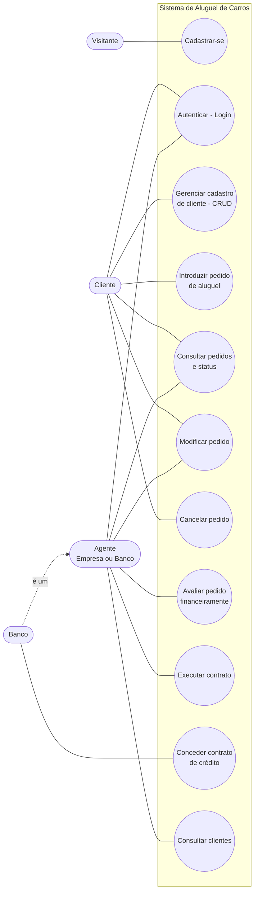

# Diagrama de Casos de Uso

## Descrição resumida

| Caso de uso | Ator | Pré-condição | Resultado |
|-------------|------|--------------|-----------|
| Cadastrar-se | Visitante | — | Usuário criado (CLIENTE, EMPRESA ou BANCO). |
| Autenticar | Cliente, Agente | Usuário cadastrado | Token de acesso emitido. |
| Gerenciar cadastro de cliente | Cliente | Autenticado | Cliente criado/consultado/alterado/excluído. |
| Introduzir pedido | Cliente | Cadastro de cliente completo | Pedido *Em análise*. |
| Consultar pedidos e status | Cliente, Agente | Autenticado | Lista/detalhe de pedidos. |
| Modificar pedido | Cliente (*Em análise*), Agente (*Em análise*/*Aprovado*) | Pedido existente | Dados atualizados. |
| Cancelar pedido | Cliente | Pedido *Em análise*/*Aprovado* | Pedido *Cancelado*. |
| Avaliar pedido | Agente | Pedido *Em análise* | *Aprovado* ou *Rejeitado* + parecer. |
| Executar contrato | Agente | Pedido *Aprovado* | Pedido *Contrato executado*. |
| Conceder crédito | Banco | Pedido não cancelado/rejeitado | Contrato de crédito associado. |
