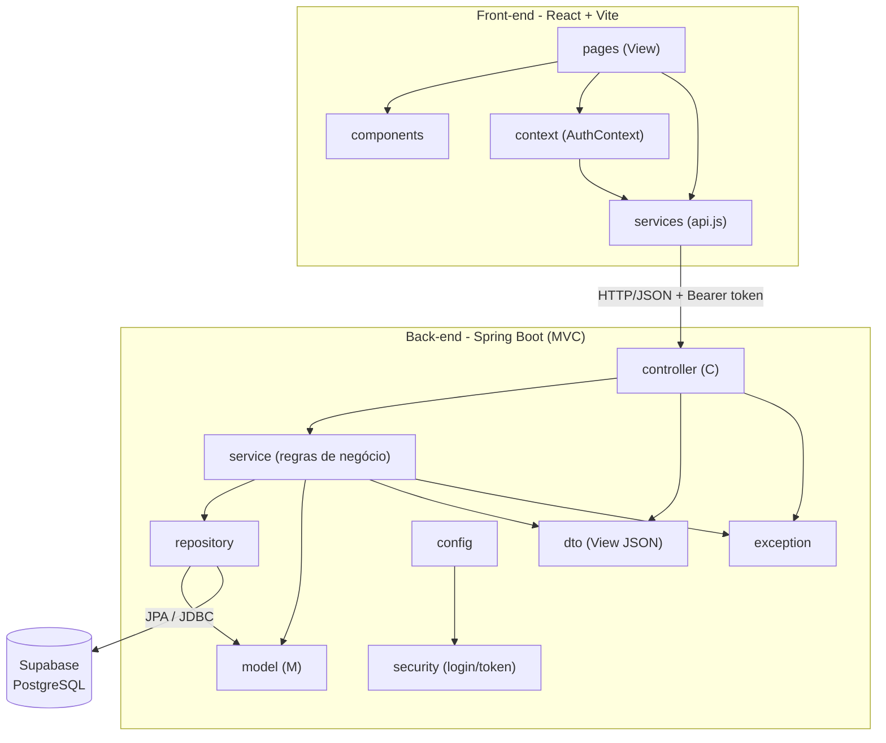

# Diagrama de Pacotes (Visão Lógica - Arquitetura MVC)

## Subsistemas (conforme o enunciado)

1. **Gestão de pedidos e contratos** – `controller`, `service`, `repository` e `model` do back-end (clientes, automóveis, pedidos, contratos de crédito).
2. **Construção dinâmica das páginas web** – front-end React (`pages`, `components`), que monta as telas a partir dos dados da API.
