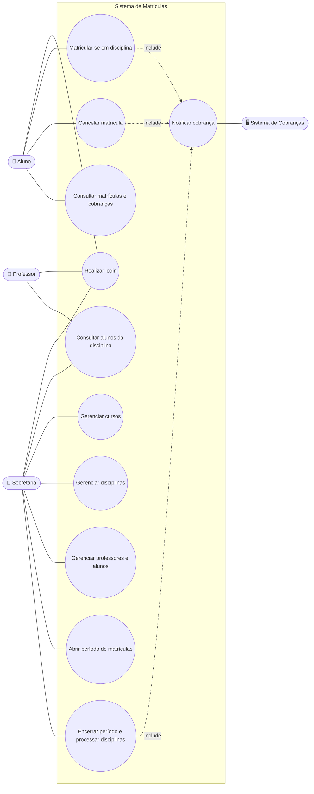
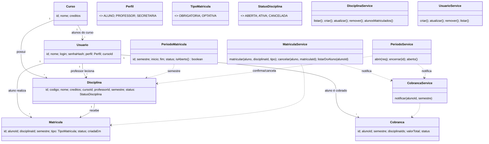

# 🎓 Sistema de Matrículas

> [!NOTE]
> Sistema web para uma universidade gerir **cursos, disciplinas, períodos de matrícula e matrículas de alunos**, com regras de negócio automatizadas (mínimo de 3 e máximo de 60 alunos por disciplina) e integração com o sistema de cobranças.

*DIAW – Laboratório 03 · Engenharia de Software · PUC Minas*


---

## 📚 Índice
- [Sobre o Projeto](#-sobre-o-projeto)
- [Modelo de Análise](#-modelo-de-análise)
  - [Diagrama de Casos de Uso](#diagrama-de-casos-de-uso)
  - [Histórias de Usuário](#histórias-de-usuário)
- [Funcionalidades e Regras de Negócio](#-funcionalidades-e-regras-de-negócio)
- [Projeto Estrutural (Diagrama de Classes)](#-projeto-estrutural-diagrama-de-classes)
- [Arquitetura](#-arquitetura)
- [Tecnologias Utilizadas](#-tecnologias-utilizadas)
- [Instalação e Execução](#-instalação-e-execução)
- [API REST](#-api-rest)
- [Estrutura de Pastas](#-estrutura-de-pastas)
- [Testes](#-testes)
- [Autores](#-autores)
- [Licença](#-licença)

---

## 📝 Sobre o Projeto

Uma universidade pretende informatizar o processo de matrículas. A **secretaria** gera o currículo de cada semestre e mantém cursos, disciplinas, professores e alunos; os **alunos** se matriculam (ou cancelam) durante o período de matrículas; os **professores** consultam quem está matriculado em suas disciplinas. Ao fim do período, o sistema confirma ou cancela cada disciplina conforme o número de inscritos e notifica o sistema de cobranças.

**Contexto:** acadêmico (DIAW – PUC Minas). **Valor entregue:** elimina o controle manual de vagas e garante o cumprimento automático das regras de matrícula.

---

## 🧭 Modelo de Análise

### Diagrama de Casos de Uso



### Histórias de Usuário

**US01 – Login.** *Como* usuário (aluno, professor ou secretaria), *quero* entrar com login e senha, *para* acessar apenas as funções do meu perfil.
- Credenciais inválidas exibem erro e não dão acesso; senhas são armazenadas com BCrypt.

**US02 – Matricular-me em disciplinas.** *Como* aluno, *quero* me matricular em disciplinas do semestre *para* montar meu currículo.
- Só é possível com período de matrículas aberto e disciplina do semestre em matrícula.
- Até **4 obrigatórias** e **2 optativas** por semestre.
- Não é possível se matricular duas vezes na mesma disciplina.
- Com **60 inscritos** a disciplina é encerrada para novas matrículas.

**US03 – Cancelar matrícula.** *Como* aluno, *quero* cancelar uma matrícula *para* ajustar meu plano enquanto o período estiver aberto.
- Cancelamento só durante o período; a cobrança é recalculada.

**US04 – Consultar minhas matrículas e cobranças.** *Como* aluno, *quero* ver minhas disciplinas e o valor cobrado *para* acompanhar meu semestre.

**US05 – Consultar alunos matriculados.** *Como* professor, *quero* listar os alunos de cada uma das minhas disciplinas *para* me preparar para as aulas.
- Professor não acessa disciplinas de outros professores.

**US06 – Gerenciar cursos.** *Como* secretaria, *quero* cadastrar, editar e excluir cursos (nome e créditos).
- Não é possível excluir curso com disciplinas vinculadas.

**US07 – Gerenciar disciplinas.** *Como* secretaria, *quero* manter as disciplinas do semestre (código, nome, créditos, curso, professor).
- Não é possível excluir disciplina com matrículas ativas.

**US08 – Gerenciar professores e alunos.** *Como* secretaria, *quero* cadastrar usuários com login e senha inicial *para* que possam acessar o sistema.
- Login único; aluno exige curso.

**US09 – Abrir período de matrículas.** *Como* secretaria, *quero* definir semestre, data de início e fim *para* liberar as matrículas.
- Apenas um período aberto por vez.

**US10 – Encerrar período e processar disciplinas.** *Como* secretaria, *quero* encerrar o período *para* confirmar ou cancelar disciplinas.
- Disciplina com **≥ 3 alunos** fica **ATIVA**; com menos, é **CANCELADA** e suas matrículas são canceladas.

**US11 – Notificar cobranças.** *Como* sistema de cobranças, *quero* ser notificado a cada mudança de matrícula *para* cobrar o aluno pelas disciplinas do semestre.

---

## ✨ Funcionalidades e Regras de Negócio

| Regra | Onde é aplicada |
| :--- | :--- |
| Máx. 4 obrigatórias + 2 optativas por aluno/semestre | `MatriculaService.matricular` |
| Mínimo 3 alunos para a disciplina ocorrer | `PeriodoService.encerrar` |
| Máximo 60 alunos; inscrições encerram ao lotar | `MatriculaService.matricular` |
| Matrícula/cancelamento só em período aberto | `MatriculaService` |
| Cobrança notificada após matrícula, cancelamento e encerramento | `CobrancaService.notificar` |
| Professor vê só alunos das próprias disciplinas | `DisciplinaService.alunosMatriculados` |
| Login obrigatório com senha (BCrypt) e perfis | `SecurityConfig` |

---

## 🧱 Projeto Estrutural (Diagrama de Classes)



> Os diagramas ficam no próprio README (Mermaid, renderizado pelo GitHub). Atualize-os sempre que o código mudar.

---

## 🏗 Arquitetura

Aplicação **cliente-servidor em camadas**:

```
React + Vite  ──HTTP/JSON (Basic Auth)──►  Spring Boot (REST)  ──►  MongoDB Atlas
                                           controller → service → repository
```

- **controller**: endpoints REST e autorização por perfil.
- **service**: regras de negócio (`MatriculaService`, `PeriodoService`, `CobrancaService`...).
- **repository**: Spring Data MongoDB.
- **model / dto**: documentos persistidos e objetos de transferência (records).
- **Segurança**: stateless, HTTP Basic com BCrypt; o front guarda as credenciais em `sessionStorage` e as envia a cada requisição. *Em produção use HTTPS (ou migre para JWT).*

---

## 🛠 Tecnologias Utilizadas

| Camada | Tecnologia |
| :--- | :--- |
| Linguagem | Java 25 |
| Back-end | Spring Boot 4.0.x (Web MVC, Security, Validation, Data MongoDB) |
| Build | Apache Maven |
| Front-end | React 19 + Vite 7 + React Router |
| Banco de dados | MongoDB Atlas |

---

## 🔧 Instalação e Execução

### Pré-requisitos
- **JDK 25**, **Maven 3.9+**, **Node.js 18+**
- Cluster **MongoDB Atlas** com seu IP liberado em *Network Access*

### 🔑 Variáveis de ambiente (arquivo `.env` na raiz)

| Variável | Descrição |
| :--- | :--- |
| `MONGODB_USER` / `MONGODB_PASSWORD` | Credenciais do usuário do Atlas |
| `MONGODB_HOST` | Host do cluster, ex.: `cluster0.ab1cd.mongodb.net` |
| `MONGODB_DATABASE` | Banco do projeto (`sistema_matriculas`) |
| `SERVER_PORT` | Porta do back-end (8080) |
| `CORS_ORIGINS` | Origens permitidas (`http://localhost:5173`) |
| `VALOR_CREDITO` | Valor de cada crédito para a cobrança |
| `SEED_ENABLED` | Popula dados de demonstração na 1ª execução |

> ⚠️ O `.env` contém segredos e está no `.gitignore`. **Nunca** o envie ao GitHub — use `.env.example`.

### ▶️ Executar (dois terminais)

```bash
# Terminal 1 – Back-end (http://localhost:8080)
cd backend
mvn spring-boot:run

# Terminal 2 – Front-end (http://localhost:5173)
cd frontend
npm install
npm run dev
```

### 👤 Usuários de demonstração (seed)

| Perfil | Login | Senha |
| :--- | :--- | :--- |
| Secretaria | `secretaria` | `secretaria123` |
| Professor | `prof.aramuni` / `prof.maria` | `prof123` |
| Aluno | `aluno1` … `aluno6` | `aluno123` |

O seed cria 1 curso, 8 disciplinas do semestre `2027.1` e um período aberto por 30 dias. **Troque as senhas fora do ambiente de testes.**

### 🧪 Roteiro de demonstração
1. `aluno1`…`aluno3` se matriculam em *DIAW*; `aluno1` tenta uma 5ª obrigatória (bloqueado).
2. `prof.aramuni` lista os alunos de *DIAW*.
3. `secretaria` encerra o período: *DIAW* fica **ATIVA** (≥ 3) e as sem inscritos ficam **CANCELADAS**.
4. `aluno1` consulta a cobrança gerada.

---

## 🌐 API REST

| Método | Rota | Perfil |
| :--- | :--- | :--- |
| GET | `/api/auth/me` | autenticado |
| GET | `/api/periodos/aberto`, `/api/cursos`, `/api/disciplinas?semestre=` | autenticado |
| GET/POST/DELETE | `/api/matriculas`, `/api/cobrancas/minhas` | ALUNO |
| GET | `/api/professor/disciplinas` | PROFESSOR |
| GET | `/api/disciplinas/{id}/alunos` | PROFESSOR (própria) / SECRETARIA |
| CRUD | `/api/cursos`, `/api/disciplinas`, `/api/usuarios` | SECRETARIA |
| GET/POST | `/api/periodos`, `/api/periodos/{id}/encerrar`, `/api/cobrancas` | SECRETARIA |

---

## 📂 Estrutura de Pastas

```
.
├── .env / .env.example
├── README.md
├── backend/                       # Spring Boot
│   ├── pom.xml
│   └── src/main/java/br/pucminas/matriculas
│       ├── config/                # SecurityConfig, DataSeeder
│       ├── controller/            # Endpoints REST
│       ├── service/               # Regras de negócio
│       ├── repository/            # Spring Data MongoDB
│       ├── model/                 # Documentos e enums
│       ├── dto/                   # Records de entrada/saída
│       └── exception/             # Exceções e handler global
└── frontend/                      # React + Vite
    └── src/ (pages/, api.js, auth.jsx, App.jsx)
```

---

## 🧪 Testes

```bash
cd backend && mvn test
```

---

## 👥 Autores

| Nome | GitHub |
| :--- | :--- |
| Vitor de Freitas Rios | [@Vfrios](https://github.com/Vfrios) |

---

## 📄 Licença

Projeto acadêmico distribuído sob a **Licença MIT**.
